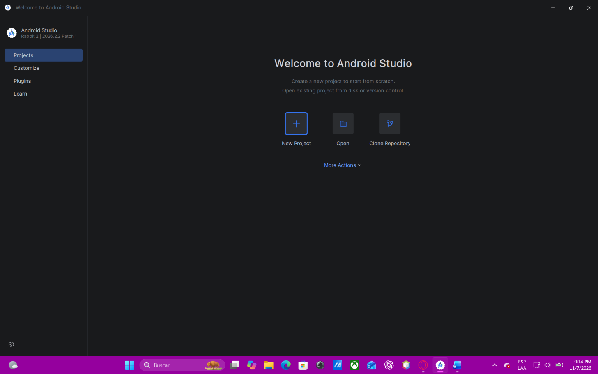
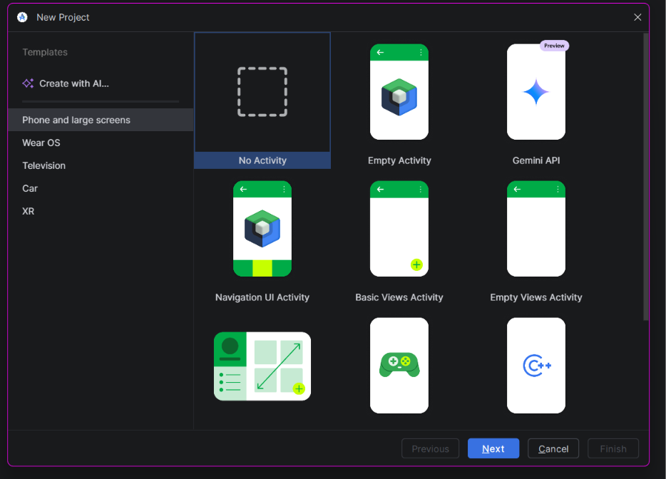
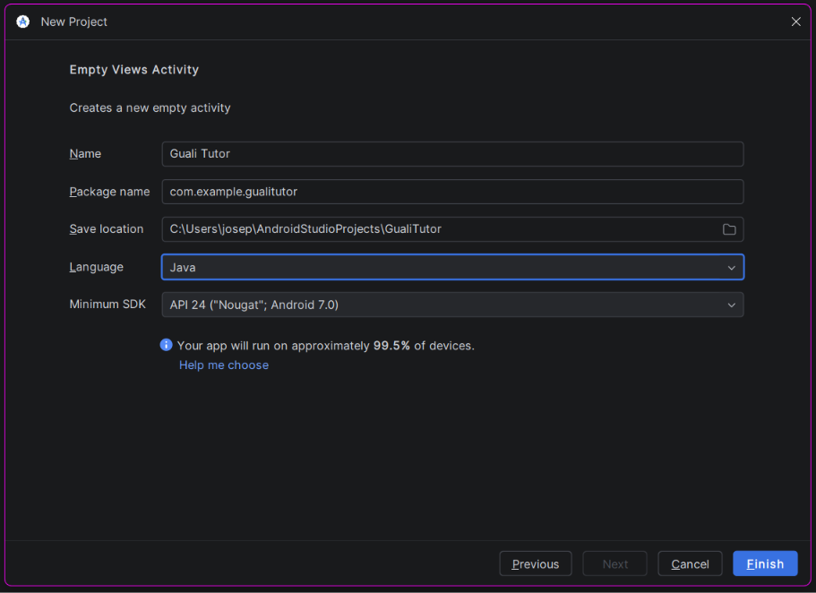
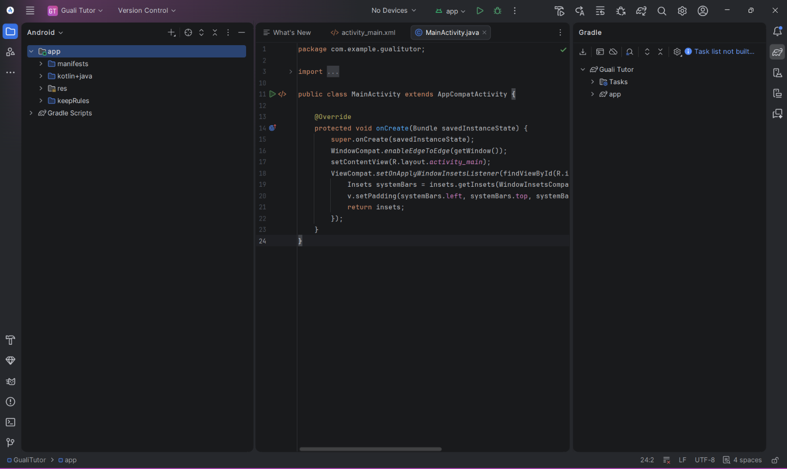
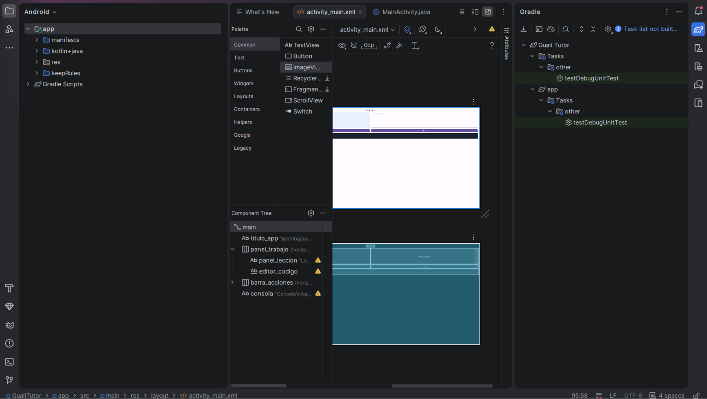
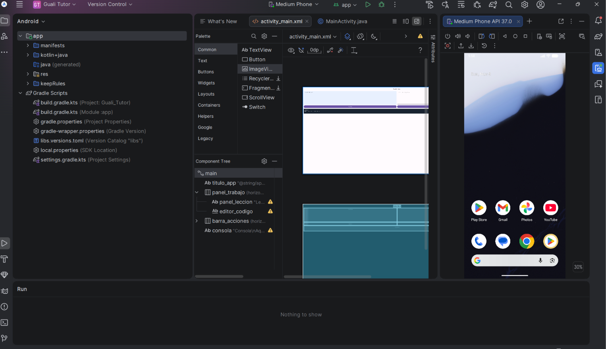
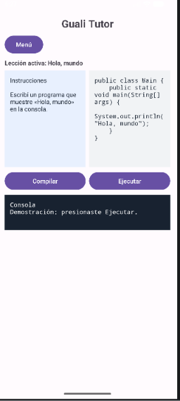
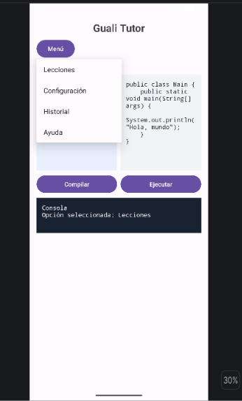

# Guali Tutor: interfaz para Android

En este tutorial voy a crear la pantalla principal de Guali Tutor en Android Studio. La app presenta una lección de ejemplo, un espacio para escribir Java y una consola. En esta fase, los botones muestran mensajes de demostración; no compilan ni ejecutan el código del editor.

## 1. Preparar e instalar las herramientas

- Una computadora con Windows, conexión a Internet y espacio para Android Studio, el SDK y la imagen del emulador.
- Android Studio, con el Android SDK y sus herramientas de compilación. Para probar en un teléfono virtual también se necesita Android Emulator y una imagen de Android.
- Una cuenta de GitHub para publicar este tutorial.

Descargo el instalador para Windows desde [Android Studio](https://developer.android.com/studio), lo ejecuto y abro el programa. En el asistente de configuración selecciono **Standard**, acepto las licencias y espero a que termine la instalación de los componentes.

Si el SDK no aparece, desde la pantalla de bienvenida entro a **More Actions → SDK Manager** y reviso **Android SDK Location**. En **SDK Platforms** instalo la plataforma que pide el proyecto y en **SDK Tools** verifico las herramientas de compilación y **Android Emulator**. Si falla una descarga, primero pruebo desde otra red antes de cambiar la ruta o volver a instalar.



## 2. Crear el proyecto

1. En la bienvenida presiono **New Project**.
2. En **Phone and large screens** selecciono **Empty Views Activity** y presiono **Next**. Esta plantilla permite editar la interfaz con XML.
3. Escribo **Guali Tutor** como nombre, dejo **com.example.gualitutor** como paquete, selecciono **Java** y dejo **API 24** como mínimo.
4. Presiono **Finish** y espero que termine la sincronización de Gradle. Cuando se carga el módulo **app**, abro los archivos de la pantalla.







## 3. Armar la pantalla en XML

Abro `app/src/main/res/layout/activity_main.xml` y elijo **Code**, el ícono de tres líneas. En el proyecto entregado, ese archivo contiene la pantalla completa. Para recrearla, uso la siguiente estructura:

| Elemento | Cómo lo agrego |
| --- | --- |
| Contenedor principal | Un `ScrollView` con ID `main`, que contiene un `LinearLayout` vertical con margen interior de `16dp`. |
| Encabezado | Un `TextView` centrado en negrita con `@string/app_name` y tamaño de `24sp`. |
| Menú | Un `Button` con ID `btn_menu` y texto **Menú**, debajo del encabezado. |
| Lección activa | Un `TextView` en negrita con el texto **Lección activa: Hola, mundo**. |
| Panel de trabajo | Un `LinearLayout` horizontal de `220dp` de alto. A la izquierda pongo el `TextView` de instrucciones y a la derecha el `EditText` editable. Ambos usan ancho `0dp` y peso `1` para repartir el espacio. |
| Editor | Al `EditText` le pongo ID `editor_codigo`, fuente `monospace` y `android:inputType="textMultiLine\|textNoSuggestions"` para escribir en varias líneas. |
| Botones | Debajo del panel agrego otro `LinearLayout` horizontal con dos botones: `btn_compilar` y `btn_ejecutar`. |
| Consola | Al final agrego un `TextView` con ID `consola`, fondo oscuro, texto blanco y altura mínima de `80dp`. |

Guardo y vuelvo a **Design** para revisar la distribución. La vista previa sirve para revisar el diseño; las acciones se comprueban con la app abierta.



## 4. Conectar el menú y los botones en Java

Abro `app/src/main/java/com/example/gualitutor/MainActivity.java`. Conservo el código de la plantilla que carga el XML y deja espacio para las barras del sistema. Agrego `import android.widget.PopupMenu;` e `import android.widget.TextView;` junto a los demás imports.

Dentro de `onCreate`, después del bloque que ajusta el espacio de las barras del sistema, agrego:

```java
TextView consola = findViewById(R.id.consola);

findViewById(R.id.btn_compilar).setOnClickListener(v ->
        consola.setText("Consola\nDemostración: presionaste Compilar."));

findViewById(R.id.btn_ejecutar).setOnClickListener(v ->
        consola.setText("Consola\nDemostración: presionaste Ejecutar."));

findViewById(R.id.btn_menu).setOnClickListener(v -> {
    PopupMenu menu = new PopupMenu(this, v);
    menu.getMenu().add("Lecciones");
    menu.getMenu().add("Configuración");
    menu.getMenu().add("Historial");
    menu.getMenu().add("Ayuda");

    menu.setOnMenuItemClickListener(opcion -> {
        consola.setText("Consola\nOpción seleccionada: " + opcion.getTitle());
        return true;
    });
    menu.show();
});
```

`findViewById` busca un elemento del XML por su ID. El código de cada botón cambia el texto de la consola cuando lo presiono.

## 5. Probar en el emulador

1. Abro **Device Manager** y uso **+ → Create Virtual Device**. En mi prueba usé **Medium Phone**, con una imagen de Android API 37. El dispositivo de prueba debe tener API 24 o superior.
2. Inicio el dispositivo con **▶** y espero hasta que aparezca la pantalla de inicio de Android en **Running Devices**.
3. Selecciono el dispositivo arriba y presiono **Run ▶**, junto a **app**. Si aparece **No target device found**, verifico que el emulador esté encendido y seleccionado.



Dentro de Guali Tutor escribo este ejemplo para comprobar que el editor acepta texto:

```java
public class Main {
    public static void main(String[] args) {
        System.out.println("Hola, mundo");
    }
}
```

Abro **Menú** y compruebo que salen las cuatro opciones. Cuando selecciono **Lecciones**, la consola muestra el nombre de la opción. Después toco **Compilar** y **Ejecutar** y verifico que cada botón muestra su propio mensaje.




